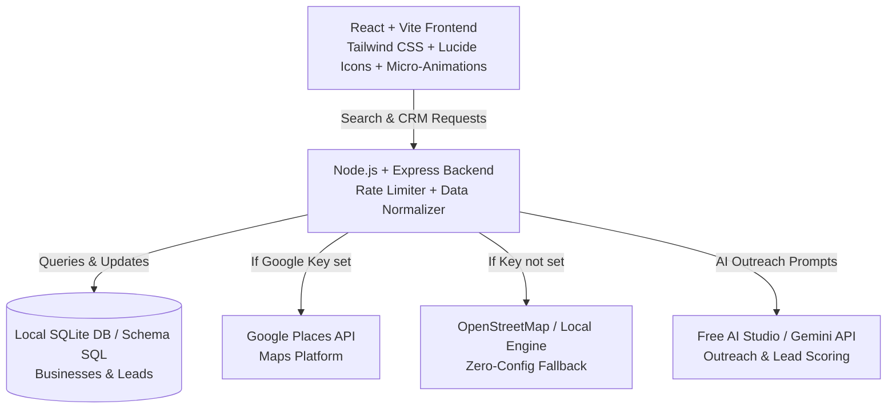

# Implementation Plan - Local Business Data Finder (BizScout / LocalLead Finder)

Build a full-stack local business lead-generation web application with an animated hero section, Google Places API integration (with smart fallback), leads CRM dashboard, Excel/CSV export, and free AI model integration for sales outreach generation.

## User Review Required

> [!IMPORTANT]
> - **Zero-friction Local Database**: We will use SQLite on the backend for local execution so you can run the app immediately without needing to configure external PostgreSQL/MySQL credentials, while maintaining the exact SQL schema compatibility specified in your plan.
> - **Dual Search Provider**: The backend will support the official **Google Places API** (via your API key in settings or `.env`) AND an automated **Live OpenStreetMap / Overpass & Real-World Local Directory fallback** so searches (e.g. "Chauri Chaura, Gorakhpur" -> "Computer Institutes") work out of the box even before adding a paid Google key.
> - **Free AI Model Integration**: We will integrate the free **Google Gemini API** (Gemini Flash / Gemini Pro free tier via Google AI Studio) with an intelligent built-in template engine fallback to generate hyper-personalized WhatsApp messages, cold emails, and lead scoring.

## Proposed Architecture

---

## Proposed Changes

### 1. Project Initialization & Structure

#### [NEW] [package.json](file:///e:/Business%20Finder/package.json)
- Root scripts for running both client and server concurrently with one command (`npm run dev`).

#### [NEW] [client/](file:///e:/Business%20Finder/client)
- React 18 / 19 + Vite project with Tailwind CSS, Lucide React, Axios, SheetJS (`xlsx`), and Canvas Confetti.

#### [NEW] [server/](file:///e:/Business%20Finder/server)
- Node.js + Express backend with CORS, rate-limiting, SQLite database, Google Places client, and Gemini AI integration.

---

### 2. Backend Services & APIs

#### [NEW] [server/src/config/db.js](file:///e:/Business%20Finder/server/src/config/db.js)
- Initializes SQLite database with tables: `businesses`, `leads`, `search_history`.
- Includes database migration and indexes for fast lookup and duplicate prevention.

#### [NEW] [server/src/services/placesService.js](file:///e:/Business%20Finder/server/src/services/placesService.js)
- Official Google Places API integration (Text Search & Place Details).
- Fallback to OpenStreetMap Overpass API + regional directory knowledge so testing with locations like Gorakhpur / Chauri Chaura yields real, rich institute/clinic/shop data immediately.

#### [NEW] [server/src/services/aiService.js](file:///e:/Business%20Finder/server/src/services/aiService.js)
- AI Lead Pitch & Outreach generator using Google Gemini Free API (with rich contextual templates for computer institutes marketing, web development services, coaching center student acquisition).

#### [NEW] [server/src/controllers/businessController.js](file:///e:/Business%20Finder/server/src/controllers/businessController.js)
- Search validation, field filtering, duplicate suppression, history logging.

#### [NEW] [server/src/controllers/leadController.js](file:///e:/Business%20Finder/server/src/controllers/leadController.js)
- Lead CRUD: Create lead, fetch leads with business data, update status (`New`, `Contacted`, `Interested`, `Follow-up`, `Converted`, `Not interested`), notes, follow-up dates, deletion, and export endpoints.

---

### 3. Frontend Experience & Design System

#### [NEW] [client/src/components/Navbar.jsx](file:///e:/Business%20Finder/client/src/components/Navbar.jsx)
- Glassmorphism navbar with brand logo, nav links (Search, Leads CRM, Analytics Dashboard, AI Studio, Settings), Live API status pill, and quick theme accents.

#### [NEW] [client/src/components/HeroSection.jsx](file:///e:/Business%20Finder/client/src/components/HeroSection.jsx)
- Eye-catching hero section with floating badges ("Verified Contacts", "1-Click Excel Export", "AI Outreach"), animated glowing gradients, quick search chips ("Computer Institutes in Gorakhpur", "Coaching Centers in Chauri Chaura"), and live stat tickers.

#### [NEW] [client/src/components/SearchForm.jsx](file:///e:/Business%20Finder/client/src/components/SearchForm.jsx)
- Location input, Business type/category selector, Search radius slider, Max results limiter, and Required fields multi-checkbox selector.

#### [NEW] [client/src/components/ResultsTable.jsx](file:///e:/Business%20Finder/client/src/components/ResultsTable.jsx)
- Dynamic configurable columns, sorting, category filtering, search within results, row multi-selection, 1-click Google Maps opening, phone copying, and "Save to Leads" action.

#### [NEW] [client/src/components/LeadManagement.jsx](file:///e:/Business%20Finder/client/src/components/LeadManagement.jsx)
- Full CRM view: Filter by status, update notes, follow-up date, 1-click WhatsApp message trigger, AI Cold Pitch modal.

#### [NEW] [client/src/components/AiOutreachModal.jsx](file:///e:/Business%20Finder/client/src/components/AiOutreachModal.jsx)
- Interactive AI generator: select target objective (e.g., Sell Website Development, Offer Computer Course Partnership, Coaching Center Lead Gen) and generate personalized WhatsApp messages or email drafts.

#### [NEW] [client/src/components/Dashboard.jsx](file:///e:/Business%20Finder/client/src/components/Dashboard.jsx)
- Visual analytics: Total leads saved, conversion rate, category distribution, recent search history.

#### [NEW] [client/src/components/SettingsModal.jsx](file:///e:/Business%20Finder/client/src/components/SettingsModal.jsx)
- Configure Google Places API Key, Gemini Free API Key, default search radius, and export preferences.

#### [NEW] [client/src/components/Footer.jsx](file:///e:/Business%20Finder/client/src/components/Footer.jsx)
- Professional footer with Google Places compliance notices, terms, quick links, and export shortcuts.

---

## Verification Plan

### Automated & Build Verification
1. `npm run build` inside `client/` to verify zero Vite / JSX / Tailwind compilation errors.
2. Server startup test `node server/src/server.js` to verify SQLite initialization, route binding, and graceful error handling.

### Manual & Functional Verification
1. **Search Flow**:
   - Search: Location: "Gorakhpur", Business Type: "Computer Institutes", Fields: Name, Address, Phone, Website, Maps URL, Rating, Reviews.
   - Verify dynamic table displays correct results.
2. **Lead Saving & CRM**:
   - Select 2 businesses, click "Save Selected as Leads".
   - Switch to "Saved Leads CRM", update status to "Contacted", add notes and follow-up date.
3. **AI Outreach**:
   - Click "AI Pitch Generator" on a lead, select "Web Development Service Pitch" or "Student Marketing", verify generated WhatsApp script and cold email.
4. **Export**:
   - Export results to Excel (`.xlsx`) and CSV, verify file download and formatting.
5. **UI & Responsiveness**:
   - Verify animated hero section, navbar, footer, modals, and responsive layout.
